# Mathan Kumar M — Source-Code Products

Screenshots, feature lists and tech stacks for the source-code products I sell on Gumroad.

> **This repository contains no product source code.** It is a showcase only. Each product is sold as a downloadable ZIP
> with the full source, a setup guide, `.env.example` placeholders and a licence for use in your own and client projects.
> You host everything yourself — these are not hosted services or subscriptions.

**Store:** https://mathankumar1.gumroad.com/

| Product | What it is | Stack | Price |
|---|---|---|---|
| [WhatsApp AI Assistant](#whatsapp-ai-assistant) | Gemini auto-replies & PDF/Word answers on the official WhatsApp Cloud API | Next.js 16 · Neon Postgres · Gemini | [$29](https://mathankumar1.gumroad.com/l/whatsapp-ai-assistant) |
| [WorkLens](#worklens) | Self-hosted AI work tracker with AI-written reports | Next.js · Express · MongoDB · FastAPI · Electron | [$19](https://mathankumar1.gumroad.com/l/worklens) |
| [Nexora Studio](#nexora-studio) | Agency / developer website with lead CRM and case-study CMS | React 19 · Vite · Convex · three.js | [$9](https://mathankumar1.gumroad.com/l/nexora-studio) |

---

## WhatsApp AI Assistant

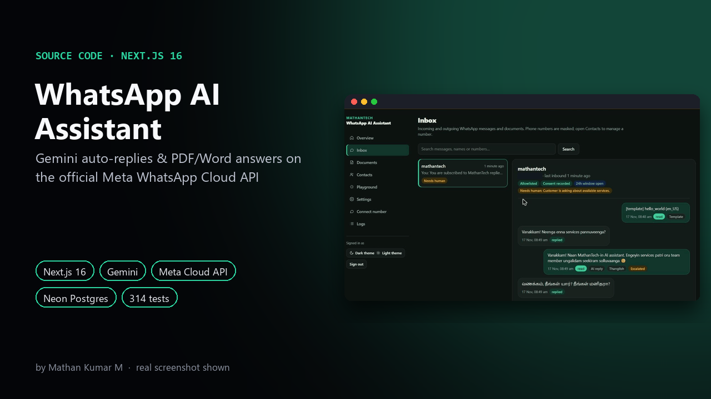

A WhatsApp auto-reply assistant for a business number, built on the **official Meta WhatsApp Cloud API** (not WhatsApp Web
automation). Customers message your number; the app verifies Meta's signed webhook, stores the message and replies with a
short answer written by Google Gemini — including answers about PDF and Word documents the customer sends.

**Features**
- Webhook signature verification (HMAC SHA-256, timing-safe) before parsing
- Durable job queue with leases; at most one automated reply per incoming message
- PDF answers via the Gemini Files API; Word answers via `mammoth` (.docx) and `word-extractor` (.doc)
- Reply policy: auto-reply off by default, Test Mode allow-list, consent, STOP/START, 24-hour window, per-contact rate limit, human takeover
- Replies in the customer's language; customer text and documents treated as untrusted input
- Admin dashboard: overview, inbox, contacts, documents, AI playground, logs, settings
- 314 automated tests (Vitest)

**You'll need:** a Meta developer account with the WhatsApp Business Platform (Cloud API), a Google Gemini API key, a Neon
account and a host such as Vercel. Meta and Google may charge for usage.

| Inbox with an AI reply | Contacts & consent |
|---|---|
| 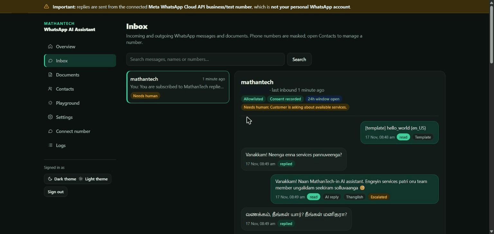 | 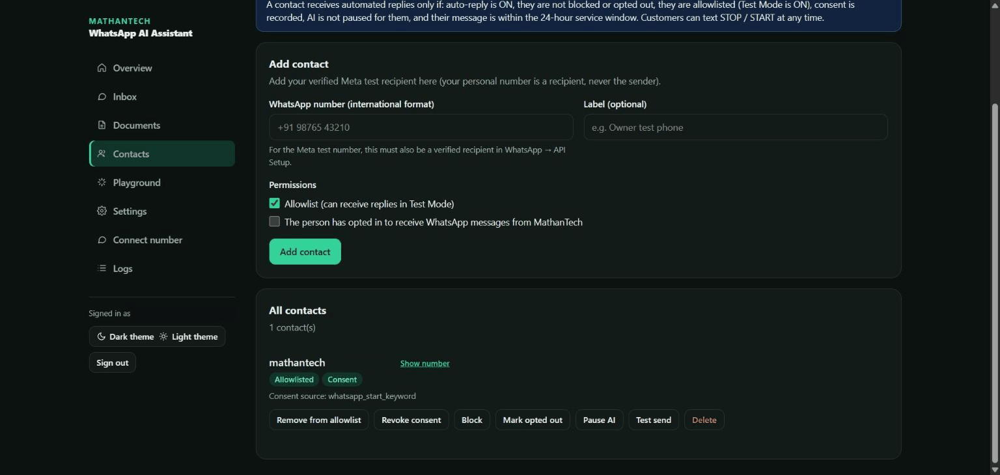 |

Dashboard images: real captures from the author's test deployment; account email and phone number blanked out.

**→ [Get the source code — $29](https://mathankumar1.gumroad.com/l/whatsapp-ai-assistant)**

---

## WorkLens

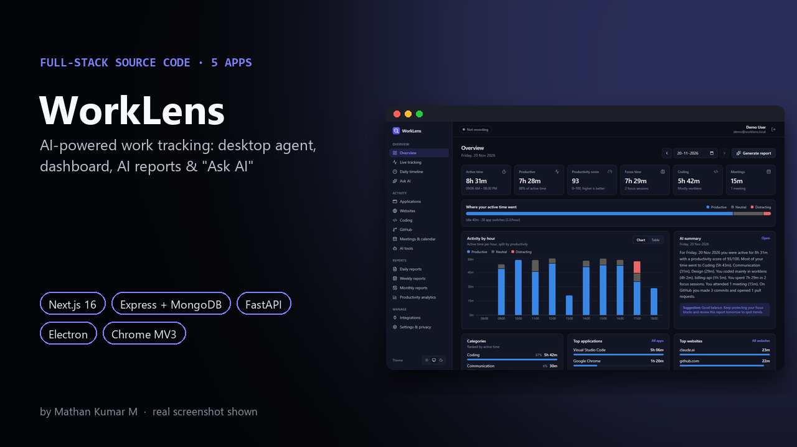

A self-hosted work tracker. A Windows desktop agent records which apps, windows and websites are used — **only while
recording is switched on** — and a web dashboard turns that into a timeline, analytics and AI-written daily, weekly and
monthly reports with PDF export and an "Ask AI" assistant. Without an AI key, a built-in rules engine still produces the reports.

**What's in the monorepo**
- Web dashboard (Next.js 16) — 20 routes
- API (Express 5, MongoDB / Mongoose 9, WebSockets)
- AI service (Python, FastAPI, ReportLab) — Anthropic or OpenAI optional
- Desktop agent (Electron, Windows) with tray, offline queue and auto-update feed
- Browser extension (Chrome / Edge / Brave, Manifest V3)
- Privacy controls: no screenshots, keystrokes, clipboard or page contents; exclusions, redaction, export and delete

**You'll need:** Node.js 20+, Python 3.11+, MongoDB 7+ and Windows 10/11 for the desktop agent. Optional: Anthropic/OpenAI
API key, your own Google/GitHub/Slack OAuth apps, and a code-signing certificate to distribute the installer.

| Dashboard | Timeline |
|---|---|
| 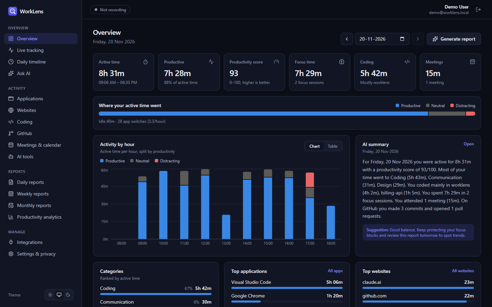 | 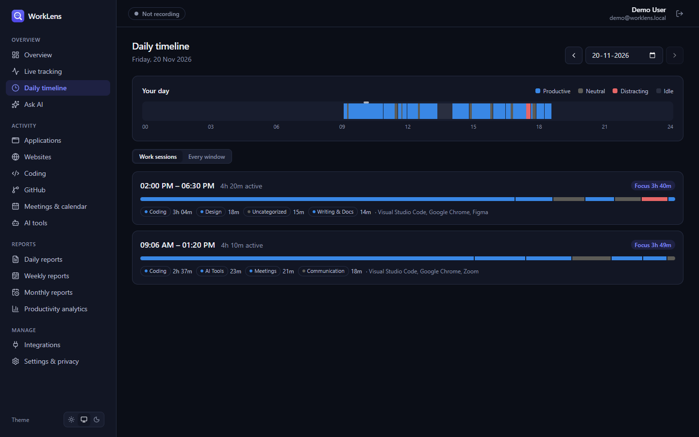 |
| **Analytics** | **Ask AI** |
| 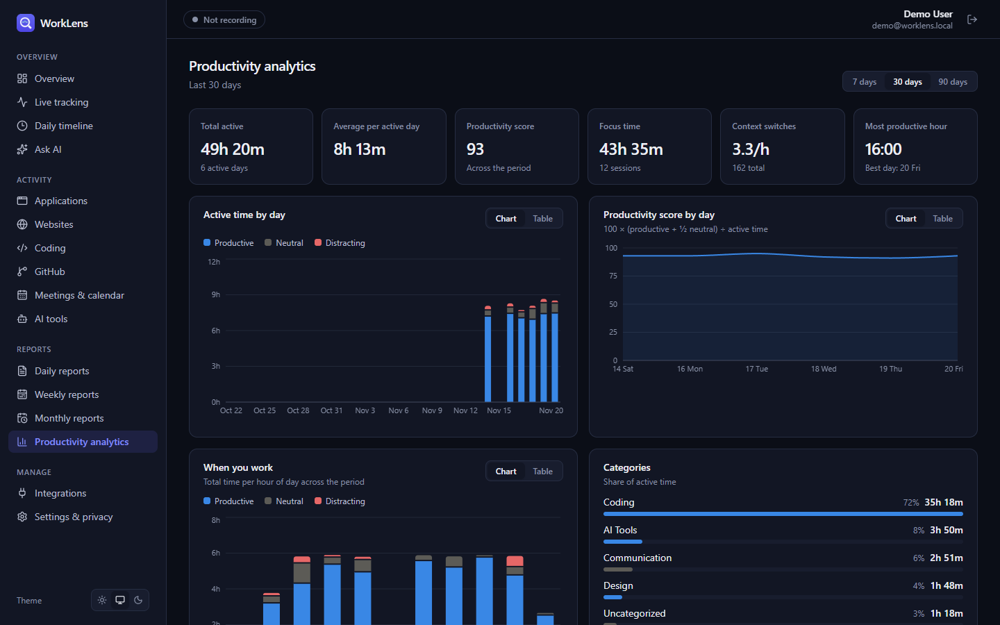 | 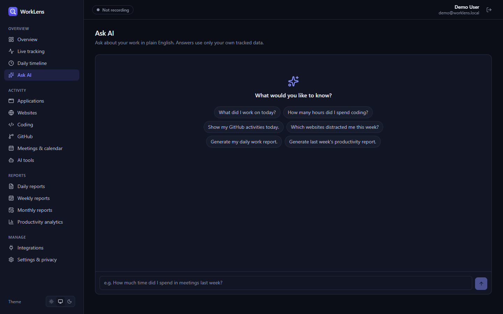 |

All WorkLens screenshots use the built-in demo account with synthetic data.

**→ [Get the source code — $19](https://mathankumar1.gumroad.com/l/worklens)**

---

## Nexora Studio

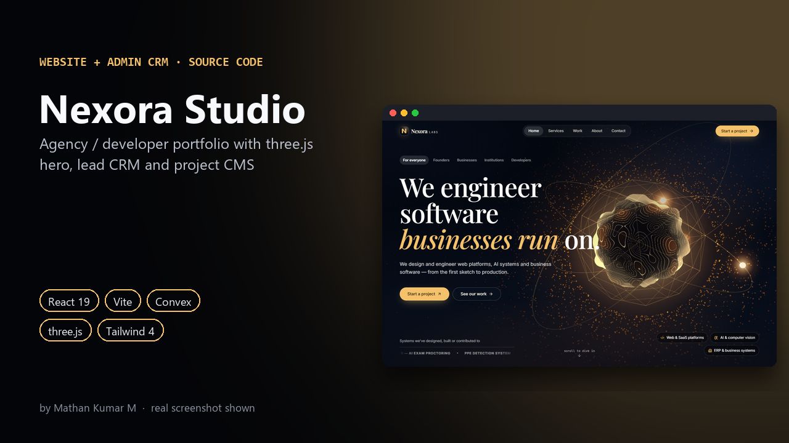

A website for a software studio or freelance developer with a private admin area. The public site has a real-time three.js
hero, portfolio and case-study pages and a contact form; the admin has a lead CRM (statuses, notes, activity), a projects CMS
with image uploads and editable site settings. Built with React 19, TypeScript and Vite on Convex.

**You'll need:** Node.js 20.19+, a Convex account and hosting for the frontend (Vercel config included). Optional: Resend for
email alerts, Cloudflare Turnstile for the bot check.

| Home | Case study |
|---|---|
| 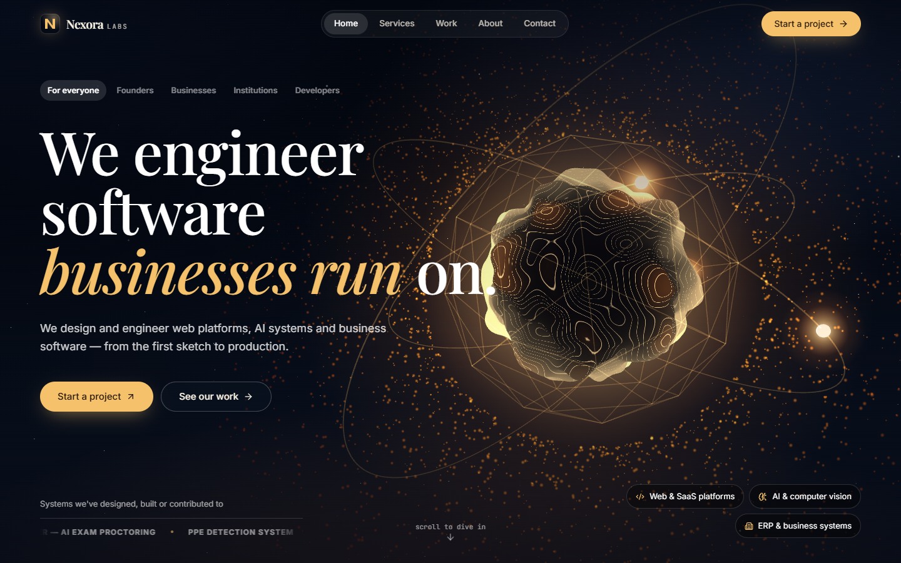 | 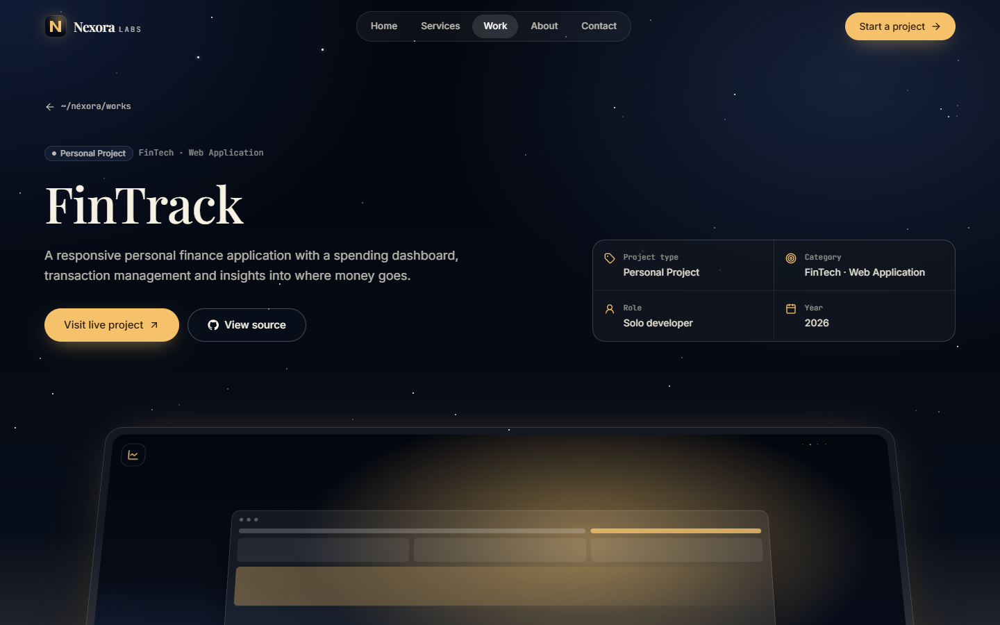 |
| **Admin dashboard** | **Projects CMS** |
| 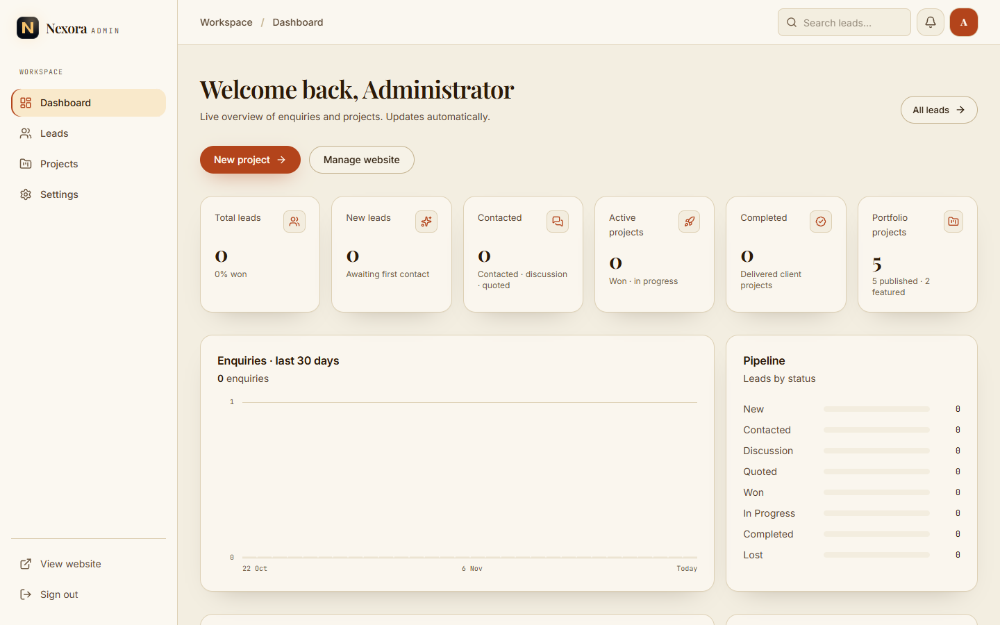 | 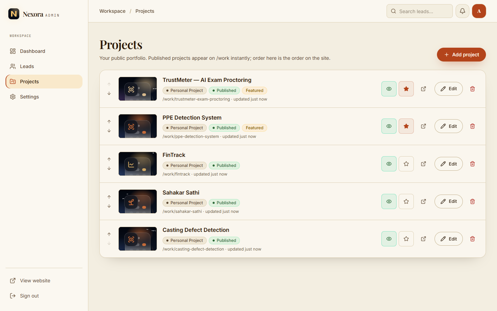 |

Screenshots from a fresh local install with the included sample content.

**→ [Get the source code — $9](https://mathankumar1.gumroad.com/l/nexora-studio)**

---

## What every purchase includes

- The complete project source as a ZIP, plus README and setup guide
- `.env.example` with placeholders — no keys, credentials or personal data
- Verified before release: installed from the ZIP into an empty folder and checked with the project's own lint, type-check, test and build steps
- Licence: use and modify in your own and your clients' projects; no resale or redistribution of the source

## About

I'm Mathan Kumar M, an AI & full-stack developer and AI & Data Science student. All products: https://mathankumar1.gumroad.com/

© 2026 Mathan Kumar M. Screenshots and text in this repository are provided for showcase purposes; all rights reserved.
